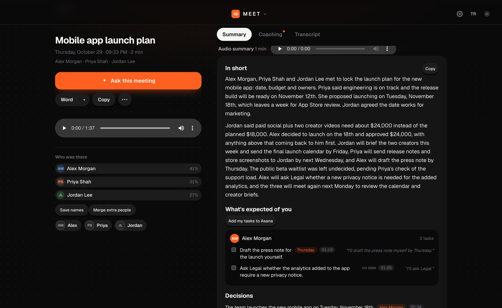
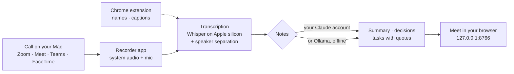

# Meet

**Meeting notes on your Mac. No bot in the call. No audio in the cloud.**

Meet records your Zoom, Google Meet, Microsoft Teams and FaceTime calls from your Mac itself, transcribes them on your Mac, and turns them
into notes you can act on: what was decided, who does what by when, and the exact sentence each of those came from.



<sub>The screenshot shows a sample meeting made for this README (synthetic voices, fictional people).</sub>

## Why Meet

- **Nobody has to invite a bot.** Meet records the audio on your Mac, the same way a screen recorder would. No "Notetaker has joined"
  tile, nothing to explain to a client, and it works in any call you can hear.
- **Your audio never leaves your Mac.** Transcription and speaker separation run on Apple silicon (Whisper on MLX). Only the text needed for
  the notes goes to Claude, through your own account, or nothing leaves at all if you use a local model.
- **Notes you can check.** Every decision and task carries the quote it is based on and a timestamp; Meet verifies the quote against the
  transcript. A task gets an owner or a date only if someone actually said one.
- **Free and open source.** MIT license. You bring the Claude plan you already have, or run fully offline with Ollama.

## Who it is for

People who spend their day in calls and need to walk out knowing what was agreed: consultants, agency and account teams, freelancers,
founders, product managers, researchers. It is especially useful when you meet clients who would rather not see a recording bot, or when
your meetings may not go to a third-party transcription service.

## What you get

**Before the meeting.** A prep note built from your earlier meetings with the same people: open tasks, unanswered questions, what was
decided last time. Without a calendar it is prepared on the Google Meet join screen, from the names you see there.

**During the meeting.** A Chrome side panel with the live transcript, a reminder when an earlier decision comes up again, short coaching
cards ("ask for a date before you move on"), and your share of the talking. A red dot in the menu bar shows that recording is on.

**After the meeting**, usually a few minutes after you hang up:

| | |
|---|---|
| **Summary** | Two short paragraphs, then the sections below. |
| **Decisions** | Only what was clearly agreed, each with who decided and the quote. |
| **Who does what** | Commitments per person, with the date if one was said. Yours first. |
| **Discussed, not decided** | Ideas that came up, kept apart from decisions. |
| **Open questions** | What still needs an answer. |
| **Coaching note** | Private to you: moments that went well, a sentence you could have used instead, one habit to try next time. |
| **Spoken summary** | A short audio version for the walk to your next call. |

Plus: ask questions across all your meetings ("what did we decide about the budget with this client?"), speaker names learned from voices
and captions, meetings that are not meetings (a weekly course, a call with family) recognised and skipped, Word / text / Markdown export,
and optional Google Drive filing and Asana tasks.

Interface in English or Turkish. Transcription detects the spoken language (Whisper's languages, including mixed-language calls).

## How it works



- A small native recorder (Swift, ScreenCaptureKit) notices when a meeting app takes the microphone and records that app's audio plus
  your microphone. It stops when the call ends.
- The optional Chrome extension reads participant names and live captions from Google Meet and Teams on the web, so the transcript says
  "Priya" instead of "Speaker 2".
- Everything is stored as plain files in the project folder. The web interface runs only on your Mac.

## Install

You need a Mac with Apple silicon, **macOS 15** or newer, [Homebrew](https://brew.sh), Git and the Xcode Command Line Tools
(`xcode-select --install`).

```bash
git clone https://github.com/yehsohimself/meet.git
cd meet
./kurulum.sh
```

The script installs `ffmpeg` and `uv`, creates a Python environment, builds the recorder and starts Meet at login. Then open
**http://127.0.0.1:8766** (later: double-click `Meet.command`). The "Getting started" card on the home page walks you through the rest:

1. **Turn on automatic recording** (Settings → Recording). The first recording asks for *Screen & System Audio Recording* and *Microphone*
   permission in System Settings → Privacy & Security.
2. **Add the Chrome extension** (optional, recommended): `chrome://extensions` → Developer mode → *Load unpacked* → the `uzanti` folder.
3. **Enter your name** (Settings → General) so your own tasks come first and your voice is recognised.
4. **Connect a calendar** (optional): a private iCal address, for meeting names and prep notes.

The speech model (~1.6 GB) downloads on first use.

### Notes need Claude or a local model

Recording, transcription and speaker separation work on their own. The notes need one of:

- **Claude** with your own plan: install [Claude Code](https://claude.com/claude-code) and sign in once (`claude auth login`). The text of
  that meeting is sent to Claude to write the notes. You can turn this off for meetings in Settings → General.
- **A local model**, nothing leaves your Mac: `brew install ollama`, `brew services start ollama`, `ollama pull gemma3:4b`. Slower, and the
  structured notes are less reliable.

## Recording other people

Meet records everyone's voice in the call. **Tell the people in the meeting that you are recording.** In many places (Germany, several US
states, and more) recording a conversation without consent is illegal. Meet never posts anything into the meeting or its chat.

## Where your data goes

| | Stays on your Mac | Leaves your Mac |
|---|---|---|
| Audio | always | never |
| Transcript | always | only the text needed for the notes, to Claude, if you chose Claude |
| Notes | always | only to services you turn on |

Integrations are off until you turn them on: Google Drive (copies notes into a folder you pick), Asana (adds your own tasks), Mail (sends the
notes to yourself), invite links for a few friends and your own phone (through a Cloudflare tunnel).

## FAQ

**Does it work with Zoom / Teams desktop apps?** Yes. The recorder works with the desktop apps and with calls in the browser; Chrome works best,
because the extension there confirms you are really in a call and supplies speaker names.

**Does the other side see anything?** No. Nothing joins the call and nothing is posted. Tell them yourself (see above).

**Windows or Intel Macs?** Not yet. The recorder uses ScreenCaptureKit, transcription uses MLX; both need macOS on Apple silicon.

**What does it cost?** Nothing. Notes use your existing Claude plan, or a free local model.

**How good is the transcript?** On clear meeting audio, Whisper large-v3-turbo is very accurate; names and jargon improve as you add them
to Settings → Frequent terms and as Meet learns the voices of the people you meet often.

## Known limits

- macOS 15+ on Apple silicon only.
- The recorder is signed on your Mac; after rebuilding it, macOS may ask for the recording permission again.
- Google Meet and Teams change their web pages now and then; speaker names from the extension may be missing until it is updated.
- Code identifiers and comments are in Turkish (the project started in Turkish); the interface is in English and Turkish.

## Development

`site.py` is a small loader; the server code lives in numbered parts (`sunucu/00_… 31_….py`) that run in one namespace. Tests:
`.venv/bin/python -m pytest tests -q`, and `.venv/bin/python duman_testi.py meet` records and transcribes a two-person sample meeting
end to end. After changing the server: `.venv/bin/python yeniden_baslat.py`. Recorder: `kaydedici/kaydedici.swift` (rebuild with
`./kurulum.sh`). Architecture notes: [docs/MIMARI.md](docs/MIMARI.md). `python sizinti.py` scans the repo for personal data.

This repo is cut from a larger workspace that builds sibling tools on the same engine; [Studio](https://github.com/yehsohimself/studio)
(video transcripts, subtitles, clips and dubbing) is public too.

Issues and pull requests are welcome. If something fails, say which meeting app and which step.

## License

MIT

---

**Türkçe:** Meet, Zoom, Google Meet, Teams ve FaceTime toplantılarınızı toplantıya bot sokmadan Mac'inizde kaydeder, Mac'te yazıya döker
ve uygulanabilir notlara çevirir: kararlar, kim ne yapacak (alıntısı ve zamanıyla), açık sorular ve size özel koçluk notu. Ses Mac'ten
çıkmaz; notlar için kendi Claude hesabınız (yalnız metin gider) ya da yerel Ollama modeli. Kurulum: yukarıdaki üç komut, sonra
http://127.0.0.1:8766. Arayüz Türkçe de kullanılabilir. Kaydettiğinizi toplantıdakilere söyleyin; birçok ülkede izin gerekir.
